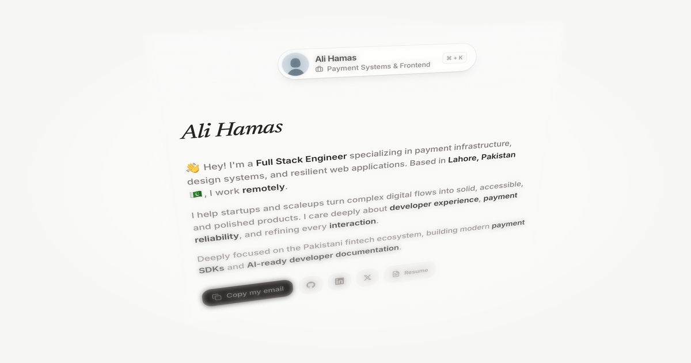

<div align="center">

# Ali Hamas — Portfolio (v2)

Personal portfolio and design engineering showcase built with Next.js App Router, React 19, TypeScript, and Tailwind CSS v4.

[**Live Demo (alihamas.pk)**](https://alihamas.pk) · [**Report Issue**](https://github.com/alihamasdev/portfolio/issues)

[](https://nextjs.org/)
[](https://react.dev/)
[](https://www.typescriptlang.org/)
[](https://tailwindcss.com/)
[](https://bun.sh/)

<br />

<a href="https://alihamas.pk">
  
</a>

</div>

---

A fast, accessible, and minimal personal portfolio designed with an editorial aesthetic. Built to showcase payment infrastructure expertise, design systems, and resilient full-stack web applications.

## Highlights

- **Editorial Typography:** Custom pairing of Newsreader italic serif headings with Inter sans-serif body text, styled using a custom monochrome stone palette.
- **Interactive Command Menu:** Floating navigation pill featuring real-time status cycling (_Available for work_, _Payment Systems & Frontend_), `⌘ + K` keyboard shortcut, and smooth accordion drawer.
- **Micro-Interactions & Transitions:** Spring-physics cubic bezier easing, squircle buttons, copy-to-clipboard feedback, and multi-layered backdrop blur gradients.
- **Theme Support:** Seamless system, light, and dark modes powered by `next-themes` with zero UI flash.
- **Modern Tooling:** High-speed development and linting powered by Turbopack, Bun, Oxlint, and Oxfmt.
- **SEO & Social Cards:** Fully typed metadata, JSON-LD schema, dynamic sitemap, robots configuration, and 3D isometric tilt-shift OpenGraph images.

## Tech Stack

| Layer                         | Technology                               |
| :---------------------------- | :--------------------------------------- |
| **Framework**                 | Next.js (App Router, Turbopack)          |
| **Library**                   | React 19                                 |
| **Language**                  | TypeScript                               |
| **Styling**                   | Tailwind CSS v4 (`@tailwindcss/postcss`) |
| **Icons**                     | Lucide React + custom SVG icons          |
| **Theme**                     | `next-themes`                            |
| **Tooling**                   | Oxlint (linter) & Oxfmt (formatter)      |
| **Runtime & Package Manager** | Bun                                      |
| **Deployment**                | Vercel                                   |

## Project Structure

```text
portfolio/
├── public/                 # Static assets (avatar, resume, og fallback)
├── scripts/
│   ├── generate-og.py     # 3D tilt-shift OpenGraph image generator
│   └── hero-capture.png   # Source capture for OG generation
└── src/
    ├── app/               # Next.js App Router (pages, layout, metadata)
    │   ├── layout.tsx     # Root layout with fonts & ThemeProvider
    │   ├── page.tsx       # Portfolio sections aggregator
    │   ├── og.jpg         # OpenGraph social banner
    │   ├── twitter.jpg    # Twitter summary_large_image banner
    │   ├── sitemap.ts     # Dynamic XML sitemap
    │   └── robots.ts      # Crawl directives
    ├── components/
    │   ├── sections/      # Hero, Experience, Projects, Tech Stack
    │   ├── menu.tsx       # Floating ⌘+K command bar & status rotator
    │   ├── theme-toggle.tsx
    │   └── blur-gradient.tsx
    ├── lib/
    │   └── contact.ts     # Centralized contact and social configuration
    └── styles/
        └── globals.css    # Tailwind CSS v4 theme, tokens & keyframes
```

## Getting Started

### Prerequisites

- [Bun](https://bun.sh/) (v1.1+ recommended) or Node.js (v20+)

### Installation

1. Clone the repository:

   ```bash
   git clone https://github.com/alihamasdev/portfolio.git
   cd portfolio
   ```

2. Install dependencies:

   ```bash
   bun install
   ```

3. Start the local development server:
   ```bash
   bun dev
   ```

Open [http://localhost:3000](http://localhost:3000) in your browser to view the site.

## Available Scripts

| Command                  | Description                                                              |
| :----------------------- | :----------------------------------------------------------------------- |
| `bun dev`                | Starts the local dev server with Turbopack                               |
| `bun run build`          | Builds the production bundle                                             |
| `bun run start`          | Runs the production build locally                                        |
| `bun run check`          | Runs Oxlint linter and Oxfmt formatter                                   |
| `bun run check-types`    | Generates route types and runs TypeScript type checking (`tsc --noEmit`) |
| `bun run og`             | Recomputes the 3D isometric tilt-shift OG images across all target paths |
| `bun run deploy:preview` | Deploys a preview environment via Vercel CLI                             |
| `bun run deploy:prod`    | Deploys directly to the production environment via Vercel CLI            |

> [!TIP]
> This project uses [Oxlint](https://oxc.rs/docs/guide/usage/linter.html) and [Oxfmt](https://oxc.rs/) for linting and formatting. Run `bun run check` before committing changes to ensure consistent code style.

> [!NOTE]
> The OpenGraph images are generated programmatically via Python (`scripts/generate-og.py`). If you update your hero copy or styling, run `bun run og` to re-render `./src/app/opengraph-image.jpg` with matching 3D perspective and optical blur.
